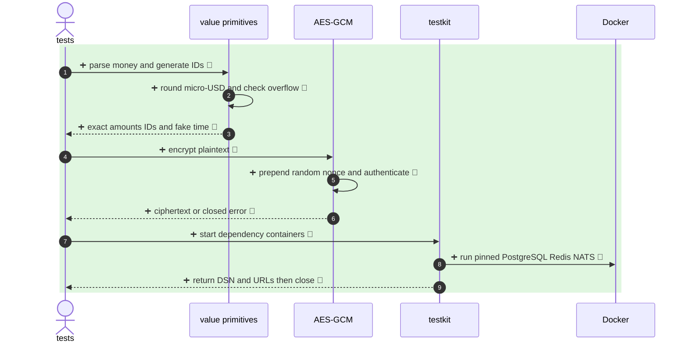

<!-- mermaidiff-key: 2af3579c66ada1c4 -->

**新增共享金额、UUIDv7、可控时钟、AES-GCM 和真实依赖测试容器能力。**

`+9 new · ❓ 1 · 🔵 9 of 9 backed by code`

- 1-3 · `internal/platform/money/money.go:17,39,49` · `internal/platform/ids/ids.go:12,16` · `internal/platform/clock/clock.go:27,37`
- 4-6 · `internal/platform/crypt/aesgcm.go:21,36,44` · AES-256-GCM rejects tampering
- 7-9 · `internal/testkit/postgres.go:23,63` · `internal/testkit/redis.go:21,46` · `internal/testkit/nats.go:21,47`

## May break

Not checked: future service consumers and external CI Docker runtime.

- ❓ Integration 测试是否应固定关闭 Ryuk，还是要求 CI 提供可用的 Ryuk sidecar？
